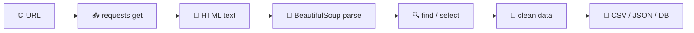
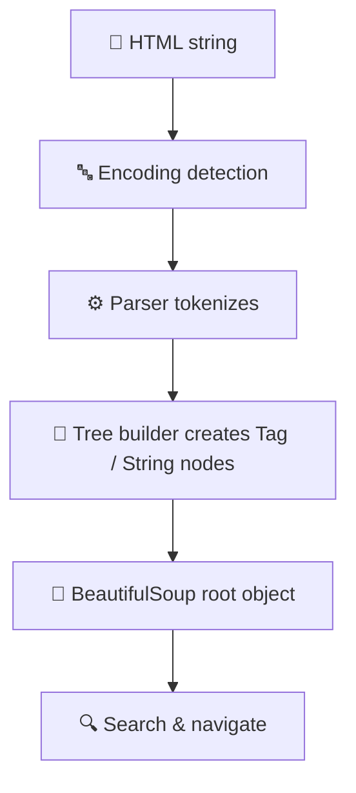
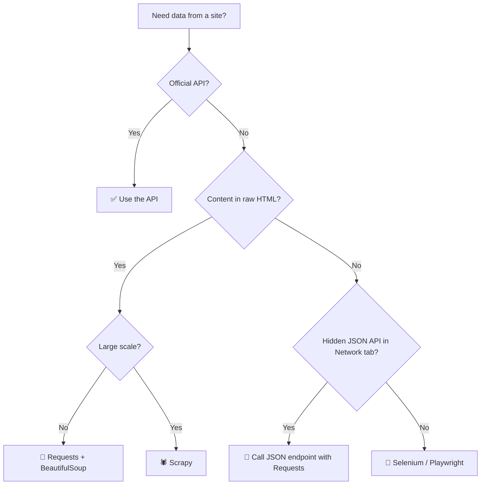
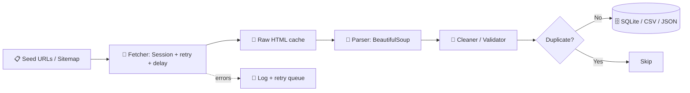

<div align="center">

# 🍜 BeautifulSoup Interview Mastery Guide

### 🐍 200 Questions · 💡 Solved with Examples · 🚀 Beginner → Advanced


</div>

---

## 📚 Table of Contents

| # | 🎯 Part | 📖 Questions | 🏷️ Level |
|---|---------|-------------|----------|
| 1 | [🟢 Basic Level](#-part-1-basic-level-questions-170) | 1 – 70 | Beginner |
| 2 | [🟡 Intermediate Level](#-part-2-intermediate-level-questions-71140) | 71 – 140 | Intermediate |
| 3 | [🔴 Hard Level](#-part-3-hard-level-questions-141200) | 141 – 200 | Advanced |

> 💡 **How to use this guide:** Every answer has a ✅ short answer and, where it helps, a 🧪 runnable example. Copy any code block and run it directly.

### 🧰 Legend

| Icon | Meaning |
|:----:|---------|
| ✅ | Answer |
| 🧪 | Example / Code |
| 💡 | Tip |
| ⚠️ | Warning / Gotcha |
| 🎤 | Interview-style answer |
| 📤 | Output |

---

## 🧪 Shared Sample HTML (used in many examples)

```python
from bs4 import BeautifulSoup

html = """
<html>
  <head><title>My Shop</title></head>
  <body>
    <h1 id="main-title" class="header big">Welcome to My Shop</h1>
    <h2>Featured</h2>
    <div class="products">
      <div class="card" data-id="101">
        
        <p class="name">Laptop</p>
        <span class="price">$900</span>
        <a href="https://shop.com/laptop">Buy</a>
      </div>
      <div class="card" data-id="102">
        
        <p class="name">Phone</p>
        <span class="price">$500</span>
        <a href="/phone">Buy</a>
      </div>
    </div>
    <ul id="menu"><li>Home</li><li>About</li><li>Contact</li></ul>
    <p>Contact: sales@shop.com</p>
  </body>
</html>
"""
soup = BeautifulSoup(html, "html.parser")
```

---

# 🟢 Part 1: Basic Level (Questions 1–70)

## 📘 A. Basic Theory Questions (1–25)

### 1️⃣ What is BeautifulSoup?
✅ A Python library that **parses HTML/XML** and gives you a tree of Python objects, so you can search and extract data easily. Think of it as a 🔍 *search engine inside a web page*.

### 2️⃣ Why use BeautifulSoup?
✅ Raw HTML is messy text. BeautifulSoup lets you say *"give me all prices"* instead of writing fragile string/regex code. It is easy, forgiving with bad HTML, and beginner-friendly.

### 3️⃣ What is web scraping?
✅ **Automatically collecting data from websites.**
🧪 *Real example:* A price-comparison site reads laptop prices from Amazon, Flipkart and others and shows the cheapest.

### 4️⃣ Web scraping vs web crawling?
| 🕷️ Crawling | ⛏️ Scraping |
|-----------|-----------|
| Discovers and follows links across pages | Extracts specific data from pages |
| Goal: find URLs (e.g. Google bot) | Goal: get prices, titles, emails |

### 5️⃣ What is HTML and why does it matter?
✅ **HyperText Markup Language**, the structure of every web page. BeautifulSoup reads this structure, so you must understand it to know *where* the data sits.

### 6️⃣ What is an HTML tag?
✅ A keyword in angle brackets that defines content type.
```html
<p>Hello</p>   <!-- <p> opening tag, </p> closing tag -->
<br>           <!-- self-closing / void tag -->
```

### 7️⃣ Tag vs Element?
✅ **Tag** = just the markers `<p>` / `</p>`. **Element** = opening tag + content + closing tag → `<p>Hello</p>`.

### 8️⃣ HTML attributes
✅ Extra info inside the opening tag as `name="value"`.
```html
<a href="https://x.com" id="link1" class="btn">Go</a>

```
| Attribute | Use |
|-----------|-----|
| `id` | Unique identifier |
| `class` | Group styling/selection (can repeat) |
| `href` | Link destination |
| `src` | Source file of an image/script |

### 9️⃣ What is the DOM?
✅ **Document Object Model**: the page represented as a **tree** (`html → body → div → p`). BeautifulSoup builds a similar tree.

### 🔟 How does BeautifulSoup convert HTML to a Python object?
✅ The parser tokenizes the HTML, then BeautifulSoup builds a tree of `Tag`, `NavigableString` and `Comment` objects under one root `BeautifulSoup` object.

### 1️⃣1️⃣ How to install?
```bash
pip install beautifulsoup4 requests lxml
```

### 1️⃣2️⃣ Purpose of the `bs4` module?
✅ `bs4` is the package name that contains BeautifulSoup. You install `beautifulsoup4` but import `bs4`.

### 1️⃣3️⃣ Why used with Requests?
✅ **Requests downloads** the page; **BeautifulSoup parses** it. Neither does the other's job.
```python
import requests
from bs4 import BeautifulSoup
r = requests.get("https://example.com")
soup = BeautifulSoup(r.text, "html.parser")
```

### 1️⃣4️⃣ Static vs Dynamic websites
| 📄 Static | ⚡ Dynamic |
|----------|-----------|
| Content is in the HTML sent by server | Content loaded by JavaScript after page load |
| BeautifulSoup works directly | Need Selenium/Playwright or the hidden API |

### 1️⃣5️⃣ Languages/technologies used in scraping
🐍 Python (BeautifulSoup, Scrapy, Selenium, Playwright), 🟨 JavaScript (Puppeteer, Cheerio), ☕ Java (Jsoup), 🐘 PHP, 💎 Ruby (Nokogiri).

### 1️⃣6️⃣ What is an HTML parser?
✅ A program that reads HTML text and converts it into a structured tree.

### 1️⃣7️⃣ Parsers supported
| Parser | Code | Notes |
|--------|------|-------|
| Built-in | `"html.parser"` | No install, decent speed |
| lxml | `"lxml"` | Fastest |
| html5lib | `"html5lib"` | Most browser-like, slowest |
| lxml-xml | `"xml"` | For XML |

### 1️⃣8️⃣ `html.parser` vs `lxml`
✅ `html.parser` is built in and pure Python. `lxml` is C-based, **faster** and handles broken HTML better, but needs installation.

### 1️⃣9️⃣ Purpose of `BeautifulSoup()` constructor
✅ Takes `(markup, parser)` and returns the parsed tree object.
```python
soup = BeautifulSoup("<p>Hi</p>", "html.parser")
```

### 2️⃣0️⃣ `prettify()`
✅ Returns the HTML as an **indented, readable string**.

### 2️⃣1️⃣ `str()` vs `prettify()`
```python
s = BeautifulSoup("<div><p>Hi</p></div>", "html.parser")
print(str(s))        # <div><p>Hi</p></div>   (compact)
print(s.prettify())  # indented, one tag per line
```

### 2️⃣2️⃣ `title` property
✅ `soup.title` returns the first `<title>` tag; `soup.title.string` returns its text → `My Shop`.

### 2️⃣3️⃣ `body` property
✅ `soup.body` returns the `<body>` tag with everything inside.

### 2️⃣4️⃣ `get_text()` vs `.text`
✅ `.text` is a property equal to `get_text()` with defaults. `get_text()` is a **method** that accepts options: `separator` and `strip`.
```python
soup.body.get_text(separator=" | ", strip=True)
```

### 2️⃣5️⃣ Advantages & disadvantages
| 👍 Advantages | 👎 Disadvantages |
|--------------|-----------------|
| Easy to learn | Cannot run JavaScript |
| Handles broken HTML | Slower than Scrapy/lxml alone |
| Great docs/community | No built-in downloading, crawling or async |

---

## 💻 B. Basic Practical Programming (26–50)

> All programs below use the shared `soup` object from the sample HTML above unless stated.

### 2️⃣6️⃣ Import BeautifulSoup
```python
from bs4 import BeautifulSoup
```

### 2️⃣7️⃣ Create a BeautifulSoup object from a string
```python
from bs4 import BeautifulSoup
soup = BeautifulSoup("<h1>Hello</h1>", "html.parser")
print(soup.h1)          # 📤 <h1>Hello</h1>
```

### 2️⃣8️⃣ Display complete HTML with `prettify()`
```python
print(soup.prettify())
```

### 2️⃣9️⃣ Extract the title
```python
print(soup.title.string)   # 📤 My Shop
```

### 3️⃣0️⃣ Extract all text
```python
print(soup.get_text(separator="\n", strip=True))
```

### 3️⃣1️⃣ First `<h1>`
```python
print(soup.h1)              # or soup.find("h1")
```

### 3️⃣2️⃣ All `<h1>` tags
```python
for h in soup.find_all("h1"):
    print(h.get_text())
```

### 3️⃣3️⃣ All `<p>` tags
```python
for p in soup.find_all("p"):
    print(p.get_text())
```

### 3️⃣4️⃣ First paragraph with `find()`
```python
print(soup.find("p").get_text())   # 📤 Laptop
```

### 3️⃣5️⃣ All paragraphs with `find_all()`
```python
paras = soup.find_all("p")
print([p.text for p in paras])
```

### 3️⃣6️⃣ All `<a>` tags
```python
print(soup.find_all("a"))
```

### 3️⃣7️⃣ `href` of an anchor
```python
a = soup.find("a")
print(a["href"])            # 📤 https://shop.com/laptop
print(a.get("href"))        # safer: returns None if missing
```

### 3️⃣8️⃣ All `` tags
```python
print(soup.find_all("img"))
```

### 3️⃣9️⃣ `src` of images
```python
for img in soup.find_all("img"):
    print(img["src"])
```

### 4️⃣0️⃣ All headings h1–h6
```python
headings = soup.find_all(["h1", "h2", "h3", "h4", "h5", "h6"])
for h in headings:
    print(h.name, "->", h.get_text())
```

### 4️⃣1️⃣ All `<div>`
```python
print(len(soup.find_all("div")))
```

### 4️⃣2️⃣ Find by `id`
```python
print(soup.find(id="main-title").text)
```

### 4️⃣3️⃣ Find by `class`
```python
for c in soup.find_all(class_="card"):   # note the underscore
    print(c["data-id"])
```

### 4️⃣4️⃣ All `<li>` in a `<ul>`
```python
for li in soup.find("ul", id="menu").find_all("li"):
    print(li.text)
```

### 4️⃣5️⃣ Count paragraphs
```python
print(len(soup.find_all("p")))     # 📤 3
```

### 4️⃣6️⃣ All links: text + URL
```python
for a in soup.find_all("a", href=True):
    print(a.text, "->", a["href"])
```

### 4️⃣7️⃣ Text from one element
```python
print(soup.find("div", class_="products").get_text(" ", strip=True))
```

### 4️⃣8️⃣ Check whether a tag exists
```python
print("exists" if soup.find("table") else "no table")
```

### 4️⃣9️⃣ First five paragraphs
```python
for p in soup.find_all("p", limit=5):
    print(p.text)
```

### 5️⃣0️⃣ All tag names in the document
```python
print(sorted({tag.name for tag in soup.find_all(True)}))
```

---

## 🧠 C. Basic Technical Interview (51–60)

### 5️⃣1️⃣ `find()` vs `find_all()`
| `find()` | `find_all()` |
|---------|-------------|
| First match only | Every match |
| Returns `Tag` or `None` | Returns `ResultSet` (list-like), `[]` if none |

### 5️⃣2️⃣ `find()` finds nothing?
✅ Returns **`None`**. Calling `.text` on it raises ⚠️ `AttributeError`. Always check first.
```python
tag = soup.find("table")
print(tag.text if tag else "N/A")
```

### 5️⃣3️⃣ What does `find_all()` return?
✅ A `ResultSet` (a subclass of list). Empty list when nothing matches, never `None`.

### 5️⃣4️⃣ `Tag` vs `NavigableString`
✅ `Tag` is an element (`<p>`). `NavigableString` is the text inside it (`"Laptop"`).
```python
t = soup.find("p")
print(type(t), type(t.string))   # Tag, NavigableString
```

### 5️⃣5️⃣ `BeautifulSoup` vs `Tag` objects
✅ `BeautifulSoup` is the **whole document** (root, name `[document]`). `Tag` is one element within it. The root supports most Tag methods.

### 5️⃣6️⃣ Access an attribute
```python
a["href"]          # KeyError if missing
a.get("href")      # None if missing
a.attrs            # dict of all attributes
```

### 5️⃣7️⃣ Multiple classes
✅ `class` is a **multi-valued attribute**, returned as a list.
```python
print(soup.h1["class"])   # 📤 ['header', 'big']
```

### 5️⃣8️⃣ `attrs` vs `get()`
✅ `.attrs` returns the whole dictionary. `.get(name)` fetches one attribute safely.

### 5️⃣9️⃣ Missing closing tags?
✅ The parser **auto-corrects** them. `<p>Hi<p>There` becomes two proper `<p>` elements.

### 6️⃣0️⃣ Can it parse broken HTML?
✅ Yes, this is a main strength. Different parsers repair differently: `html5lib` mimics a browser most closely, `lxml` is fast and forgiving.
```python
print(BeautifulSoup("<b><i>text</b>", "html.parser"))
```

---

## 🎤 D. Basic One-to-One Interview (61–70)

### 6️⃣1️⃣ Explain BeautifulSoup in your own words
🎤 *"BeautifulSoup is a Python library that turns raw HTML into a navigable tree, so I can find tags by name, class or id and pull out text and attributes without manual string handling."*

### 6️⃣2️⃣ Why not process HTML manually?
🎤 Regex and string splitting break on nesting, attribute order, whitespace and malformed tags. BeautifulSoup understands structure, so code is shorter and more reliable.

### 6️⃣3️⃣ Complete working flow


### 6️⃣4️⃣ Have you built a scraper?
🎤 Use this template: *"Yes, a product scraper. It takes a category URL, loops through pages with Requests, parses cards with BeautifulSoup, extracts name, price, rating and link, removes duplicates, and saves to CSV and JSON."* (Full code in Q200.)

### 6️⃣5️⃣ First step when scraping a site?
1. 🔎 Open the site and **inspect** it (F12 → Elements/Network)
2. 🤖 Check `robots.txt` and terms
3. 📄 Confirm data is in the raw HTML (View Source) and not JS-loaded
4. 🧪 Test one request in Python

### 6️⃣6️⃣ Extract product names
```python
names = [p.get_text(strip=True) for p in soup.select("div.card p.name")]
print(names)   # 📤 ['Laptop', 'Phone']
```

### 6️⃣7️⃣ Extract prices
```python
prices = [float(s.text.replace("$", "").replace(",", ""))
          for s in soup.select("span.price")]
print(prices)  # 📤 [900.0, 500.0]
```

### 6️⃣8️⃣ Handle a missing element
```python
def safe_text(parent, selector, default="N/A"):
    el = parent.select_one(selector)
    return el.get_text(strip=True) if el else default
```

### 6️⃣9️⃣ Problems when scraping
⚠️ Missing tags, changed layout, blocks/403/429, JavaScript-rendered content, pagination, encoding problems, duplicates, CAPTCHAs, slow responses.

### 7️⃣0️⃣ Website changed its HTML?
🛠️ Re-inspect the page, update selectors, centralize selectors in one config dict, add tests/alerts for empty results, and prefer stable attributes (`data-*`, IDs) over positions.

---

# 🟡 Part 2: Intermediate Level (Questions 71–140)

## 📘 A. Intermediate Theory (71–90)

### 7️⃣1️⃣ Internal working of BeautifulSoup
✅ BeautifulSoup itself is **not** a parser. It wraps a parser (`html.parser`, `lxml`, `html5lib`). The parser emits events (start tag, text, end tag); BeautifulSoup's *tree builder* turns them into linked `Tag` / `NavigableString` objects, each with `parent`, `next_element`, `next_sibling` pointers.

### 7️⃣2️⃣ Parsing process: string → object


### 7️⃣3️⃣ `html.parser` vs `lxml` vs `html5lib` vs `xml`
| Parser | Speed | Leniency | Dependency | Best for |
|--------|:----:|:-------:|:---------:|----------|
| `html.parser` | ⚡⚡ | Medium | None | Simple scripts |
| `lxml` | ⚡⚡⚡ | Good | C library | Speed, large pages |
| `html5lib` | 🐢 | Best (browser-like) | Pure Python | Very broken HTML |
| `xml` (lxml-xml) | ⚡⚡⚡ | Strict | lxml | XML / RSS / sitemaps |

### 7️⃣4️⃣ Advantages of `lxml`
🚀 Very fast, 🧹 handles messy HTML well, 🔎 supports XPath when used directly, 📦 good for big documents.

### 7️⃣5️⃣ HTML vs XML parsing
✅ HTML parsing is **lenient** (auto-closes tags, knows void tags like `<br>`). XML parsing is **strict** (must be well-formed, case-sensitive, preserves custom tags).
```python
BeautifulSoup(xml_text, "xml")   # needs lxml
```

### 7️⃣6️⃣ `find()` vs `find_all()` vs `select()`
| Method | Input | Returns |
|--------|-------|---------|
| `find` | name/attrs | first Tag or None |
| `find_all` | name/attrs | list of Tags |
| `select` | **CSS selector** | list of Tags |
| `select_one` | CSS selector | first Tag or None |

### 7️⃣7️⃣ CSS selectors
✅ The same patterns used in CSS to target elements.
| Selector | Meaning |
|----------|---------|
| `p` | all `<p>` |
| `.card` | class card |
| `#menu` | id menu |
| `div.card > p` | `p` directly inside `div.card` |
| `div p` | any `p` inside a div |
| `a[href^="https"]` | href starts with https |
| `li:nth-of-type(2)` | second li |

### 7️⃣8️⃣ `select_one()`
```python
print(soup.select_one("div.card p.name").text)   # 📤 Laptop
```

### 7️⃣9️⃣ `select()`
```python
for el in soup.select("div.card span.price"):
    print(el.text)
```

### 8️⃣0️⃣ ID vs class selection
| ID | Class |
|----|-------|
| Should be **unique** per page | Reusable on many elements |
| `#main-title` / `find(id=...)` | `.card` / `find_all(class_=...)` |

### 8️⃣1️⃣ `recursive` in `find_all()`
✅ `recursive=False` searches **only direct children**, not deeper levels.
```python
soup.find("div", class_="products").find_all("div", recursive=False)
```

### 8️⃣2️⃣ `limit` in `find_all()`
✅ Stops after N results (faster).
```python
soup.find_all("p", limit=2)
```

### 8️⃣3️⃣ `string` parameter
✅ Match by exact text (or regex).
```python
import re
soup.find("p", string="Laptop")
soup.find_all("span", string=re.compile(r"\$\d+"))
```

### 8️⃣4️⃣ `string` vs `text` vs `get_text()`
| Name | Behavior |
|------|----------|
| `.string` | The single string inside; `None` if multiple children |
| `.text` | All nested text joined |
| `.get_text(sep, strip)` | Same as text but configurable |

### 8️⃣5️⃣ `attrs` parameter
```python
soup.find_all("div", attrs={"class": "card", "data-id": "101"})
```
💡 Useful for attributes with dashes (`data-id`) that cannot be Python keywords.

### 8️⃣6️⃣ `name` parameter
✅ Tag name, list, regex, or function.
```python
soup.find_all(name="a")
soup.find_all(["h1", "h2"])
soup.find_all(re.compile("^h[1-6]$"))
```

### 8️⃣7️⃣ `parent`, `parents`, `children`, `descendants`
| Property | Meaning |
|----------|---------|
| `.parent` | Direct parent |
| `.parents` | Generator of all ancestors |
| `.children` | Direct children (iterator) |
| `.descendants` | All nested elements (generator) |

### 8️⃣8️⃣ `next_sibling` vs `next_element`
✅ `next_sibling` = next node at **same level**. `next_element` = next node in **parse order** (may go *inside* the tag). ⚠️ Whitespace `"\n"` counts as a sibling.

### 8️⃣9️⃣ `previous_sibling` vs `previous_element`
✅ Mirror of the above, going backwards.

### 9️⃣0️⃣ Tree navigation overview
```
        html
       /    \
    head    body
     |      /  \
   title   h1   div.products
                 /       \
            div.card   div.card
```
Move **down** (`.contents`, `.children`), **up** (`.parent`), **sideways** (`.next_sibling`, `.find_next_sibling()`).

---

## 💻 B. Intermediate Practical (91–115)

### 9️⃣1️⃣ Elements with a class
```python
print(soup.find_all("div", class_="card"))
print(soup.select(".card"))
```

### 9️⃣2️⃣ Multiple CSS classes
```python
soup.select("h1.header.big")           # has BOTH classes
soup.find_all(class_="header big")     # exact string match
```

### 9️⃣3️⃣ CSS ID selector
```python
print(soup.select_one("#main-title").text)
```

### 9️⃣4️⃣ Links inside a div
```python
for a in soup.select("div.products a"):
    print(a["href"])
```

### 9️⃣5️⃣ Parent of an element
```python
price = soup.find("span", class_="price")
print(price.parent["class"])     # 📤 ['card']
```

### 9️⃣6️⃣ Child elements
```python
ul = soup.find("ul")
for child in ul.find_all(recursive=False):
    print(child.name, child.text)
```

### 9️⃣7️⃣ Descendants
```python
for d in soup.find("div", class_="card").descendants:
    if d.name:
        print(d.name)
```

### 9️⃣8️⃣ Next sibling
```python
first = soup.find("li")
print(first.find_next_sibling("li").text)    # 📤 About
```

### 9️⃣9️⃣ Previous sibling
```python
last = soup.find_all("li")[-1]
print(last.find_previous_sibling("li").text) # 📤 About
```

### 1️⃣0️⃣0️⃣ Navigate parent / child / sibling
```python
name = soup.find("p", class_="name")
print(name.parent.name)                      # div
print(name.find_next_sibling("span").text)   # $900
print(name.find_previous_sibling("img")["alt"])  # Laptop
```

### 1️⃣0️⃣1️⃣ Nested text with `get_text()`
```python
print(soup.find("div", class_="card").get_text(" | ", strip=True))
# 📤 Laptop | $900 | Buy
```

### 1️⃣0️⃣2️⃣ Clean spaces and newlines
```python
import re
raw = soup.body.get_text()
clean = re.sub(r"\s+", " ", raw).strip()
print(clean)
```

### 1️⃣0️⃣3️⃣ Elements with a specific attribute
```python
soup.find_all(attrs={"data-id": True})
soup.select("[data-id]")
```

### 1️⃣0️⃣4️⃣ Multiple attributes at once
```python
soup.find_all("div", {"class": "card", "data-id": "102"})
soup.select('div.card[data-id="102"]')
```

### 1️⃣0️⃣5️⃣ Links starting with https
```python
soup.select('a[href^="https"]')
# or
[a for a in soup.find_all("a", href=True) if a["href"].startswith("https")]
```

### 1️⃣0️⃣6️⃣ Images that have `alt`
```python
soup.find_all("img", alt=True)
soup.select("img[alt]")
```

### 1️⃣0️⃣7️⃣ Extract all tables
```python
tables = soup.find_all("table")
print(f"Found {len(tables)} tables")
```

### 1️⃣0️⃣8️⃣ Table headings and rows separately
```python
table_html = """
<table>
  <tr><th>Name</th><th>Age</th></tr>
  <tr><td>Ravi</td><td>25</td></tr>
  <tr><td>Anu</td><td>30</td></tr>
</table>"""
t = BeautifulSoup(table_html, "html.parser").find("table")
headers = [th.text for th in t.find_all("th")]
rows = [[td.text for td in tr.find_all("td")]
        for tr in t.find_all("tr") if tr.find("td")]
print(headers)  # ['Name', 'Age']
print(rows)     # [['Ravi', '25'], ['Anu', '30']]
```

### 1️⃣0️⃣9️⃣ Table → Python list of dicts
```python
data = [dict(zip(headers, r)) for r in rows]
print(data)  # [{'Name': 'Ravi', 'Age': '25'}, {'Name': 'Anu', 'Age': '30'}]
```

### 1️⃣1️⃣0️⃣ Product name, price, rating
```python
html = """
<div class="item"><h3>Phone</h3><span class="price">₹15,000</span><span class="rating">4.5</span></div>
<div class="item"><h3>TV</h3><span class="price">₹40,000</span></div>
"""
s = BeautifulSoup(html, "html.parser")
products = []
for it in s.select("div.item"):
    rating = it.select_one(".rating")
    products.append({
        "name": it.h3.get_text(strip=True),
        "price": it.select_one(".price").get_text(strip=True),
        "rating": rating.get_text(strip=True) if rating else None,
    })
print(products)
```

### 1️⃣1️⃣1️⃣ Email addresses from visible text
```python
import re
text = soup.get_text(" ")
emails = set(re.findall(r"[\w.+-]+@[\w-]+\.[\w.-]+", text))
print(emails)   # {'sales@shop.com'}
```

### 1️⃣1️⃣2️⃣ External links
```python
from urllib.parse import urlparse
site = "shop.com"
external = [a["href"] for a in soup.find_all("a", href=True)
            if a["href"].startswith("http") and urlparse(a["href"]).netloc != site]
```

### 1️⃣1️⃣3️⃣ Internal links
```python
internal = [a["href"] for a in soup.find_all("a", href=True)
            if a["href"].startswith("/") or urlparse(a["href"]).netloc == site]
```

### 1️⃣1️⃣4️⃣ Elements whose text contains a keyword
```python
import re
for el in soup.find_all(string=re.compile("laptop", re.I)):
    print(el.parent.name, el.strip())
```

### 1️⃣1️⃣5️⃣ Regex with BeautifulSoup
```python
import re
soup.find_all(re.compile(r"^h[1-6]$"))              # tag names
soup.find_all("a", href=re.compile(r"^https?://"))  # attribute values
soup.find_all(class_=re.compile("card"))
```

---

## 🌐 C. Requests + BeautifulSoup (116–130)

### 1️⃣1️⃣6️⃣ What is Requests?
✅ A simple Python HTTP library for sending GET/POST requests.

### 1️⃣1️⃣7️⃣ How they work together
```python
import requests
from bs4 import BeautifulSoup
r = requests.get("https://example.com", timeout=10)
soup = BeautifulSoup(r.text, "html.parser")
print(soup.title.text)
```

### 1️⃣1️⃣8️⃣ `requests.get()`
✅ Sends an HTTP GET request and returns a `Response` object.

### 1️⃣1️⃣9️⃣ `status_code`
| Code | Meaning |
|:----:|---------|
| 200 ✅ | OK |
| 301/302 🔀 | Redirect |
| 403 🚫 | Forbidden / blocked |
| 404 ❓ | Not found |
| 429 ⏳ | Too many requests |
| 500 💥 | Server error |

### 1️⃣2️⃣0️⃣ `response.text` vs `response.content`
✅ `.text` = decoded **string**. `.content` = raw **bytes** (use for images, files, or to let BeautifulSoup detect encoding).

### 1️⃣2️⃣1️⃣ Purpose of headers
✅ They describe the client (browser type, language, accepted content). Sites may block requests that look like bots.

### 1️⃣2️⃣2️⃣ User-Agent
```python
headers = {"User-Agent": "Mozilla/5.0 (Windows NT 10.0; Win64; x64) AppleWebKit/537.36 Chrome/124 Safari/537.36"}
r = requests.get(url, headers=headers, timeout=10)
```
💡 Default `python-requests/x.y` is often blocked.

### 1️⃣2️⃣3️⃣ `raise_for_status()`
✅ Raises `HTTPError` for 4xx/5xx so failures are not silently parsed.
```python
r = requests.get(url, timeout=10)
r.raise_for_status()
```

### 1️⃣2️⃣4️⃣ GET vs POST
| GET | POST |
|-----|------|
| Data in URL query string | Data in request body |
| Fetch/read pages | Submit forms, login, search APIs |

```python
requests.get(url, params={"q": "laptop"})
requests.post(url, data={"user": "a", "pass": "b"})
```

### 1️⃣2️⃣5️⃣ `timeout`
✅ Prevents hanging forever. `timeout=10` or `(connect, read)` like `(3, 10)`.

### 1️⃣2️⃣6️⃣ Handle connection errors
```python
import requests
try:
    r = requests.get(url, timeout=10)
    r.raise_for_status()
except requests.exceptions.Timeout:
    print("⏱️ Timed out")
except requests.exceptions.ConnectionError:
    print("🔌 Connection failed")
except requests.exceptions.HTTPError as e:
    print("🚫 HTTP error:", e)
except requests.exceptions.RequestException as e:
    print("❌ Other error:", e)
```

### 1️⃣2️⃣7️⃣ Pagination
✅ Data split across pages: `?page=1`, `?page=2`, or a "Next" button.

### 1️⃣2️⃣8️⃣ Scraping multiple pages
```python
import time
all_items = []
for page in range(1, 6):
    r = requests.get(f"https://example.com/products?page={page}", timeout=10)
    s = BeautifulSoup(r.text, "html.parser")
    cards = s.select("div.card")
    if not cards:
        break                       # 🛑 no more pages
    all_items.extend(cards)
    time.sleep(1)                   # 😇 be polite
```
**"Next" link version:**
```python
url = "https://example.com/products"
while url:
    s = BeautifulSoup(requests.get(url, timeout=10).text, "html.parser")
    # ... extract ...
    nxt = s.select_one("a.next")
    url = urljoin(url, nxt["href"]) if nxt else None
```

### 1️⃣2️⃣9️⃣ Absolute vs relative URLs
| Absolute | Relative |
|----------|----------|
| `https://shop.com/phone` | `/phone`, `../phone`, `phone` |

### 1️⃣3️⃣0️⃣ Relative → absolute
```python
from urllib.parse import urljoin
print(urljoin("https://shop.com/products/", "/phone"))   # https://shop.com/phone
print(urljoin("https://shop.com/products/", "item1"))    # https://shop.com/products/item1
```

---

## 🎤 D. Intermediate One-to-One Interview (131–140)

### 1️⃣3️⃣1️⃣ 100 product cards: name, price, image, link
```python
from urllib.parse import urljoin
base = "https://shop.com/"
items = []
for card in soup.select("div.card"):
    name  = card.select_one("p.name")
    price = card.select_one("span.price")
    img   = card.select_one("img")
    link  = card.select_one("a[href]")
    items.append({
        "name":  name.get_text(strip=True) if name else None,
        "price": price.get_text(strip=True) if price else None,
        "image": urljoin(base, img["src"]) if img and img.get("src") else None,
        "url":   urljoin(base, link["href"]) if link else None,
    })
print(len(items), items[0])
```

### 1️⃣3️⃣2️⃣ `find_all()` returns `[]` → debug
1. ✅ Print `r.status_code` and `len(r.text)`
2. 👀 Save `r.text` to a file and open it, since you may have received a CAPTCHA or block page
3. 🔍 Compare **View Source** with Inspect: is it JS-rendered?
4. 🔤 Check selector spelling, class names (`class_`), whitespace
5. 🧪 Try a different parser (`lxml`, `html5lib`)
6. 🌐 Check headers/cookies, and iframes

### 1️⃣3️⃣3️⃣ Many elements with same class
```python
for i, el in enumerate(soup.find_all("div", class_="card"), 1):
    print(i, el.p.text)       # loop and scope searches to each element
```
💡 Always search **inside** each element (`el.select_one`) not the whole `soup`.

### 1️⃣3️⃣4️⃣ Multiple pages
✅ Use a loop over `?page=N` or follow the "Next" link; stop when no items/next link; add `sleep()`. See Q128.

### 1️⃣3️⃣5️⃣ Missing prices or names
✅ Use helper with default, store `None`/`"N/A"`, optionally log skipped items, never let one bad card crash the loop.

### 1️⃣3️⃣6️⃣ Prevent duplicates
```python
seen, unique = set(), []
for p in items:
    key = p["url"] or p["name"]
    if key not in seen:
        seen.add(key)
        unique.append(p)
```

### 1️⃣3️⃣7️⃣ HTTP 403
1. Add realistic `User-Agent` and `Accept-Language` headers
2. Use `requests.Session()` for cookies
3. Slow down, add delays
4. Check `robots.txt` and the terms. ⚠️ Do **not** bypass protections the site clearly forbids
5. Look for an official API

### 1️⃣3️⃣8️⃣ Nested tables
```python
outer = soup.find("table")
for row in outer.find_all("tr", recursive=False):   # direct rows only
    for inner in row.find_all("table"):
        pass  # parse the inner table separately
```
💡 Use `recursive=False` so inner-table rows are not mixed with outer rows (also check for `<tbody>`).

### 1️⃣3️⃣9️⃣ Store in CSV
```python
import csv
with open("products.csv", "w", newline="", encoding="utf-8") as f:
    w = csv.DictWriter(f, fieldnames=["name", "price", "image", "url"])
    w.writeheader()
    w.writerows(items)
```

### 1️⃣4️⃣0️⃣ Real-world project idea
🎤 *"A price tracker: scrape product pages daily, save prices to a database, and email me when price drops below a target. Stack: Requests + BeautifulSoup + SQLite + smtplib + a scheduler (cron)."*
Other ideas: 📰 news aggregator, 💼 job board scraper, 🏠 real-estate listings, 📚 book catalog.

---

# 🔴 Part 3: Hard Level (Questions 141–200)

## 📘 A. Advanced Theory (141–155)

### 1️⃣4️⃣1️⃣ Object hierarchy
```
BeautifulSoup   ← whole document (root)
 └── Tag         ← <p>, <div> ... (has name, attrs, children)
      ├── NavigableString ← text inside tags
      └── Comment         ← <!-- comment --> (special string)
```
```python
from bs4 import BeautifulSoup, Comment, NavigableString, Tag
s = BeautifulSoup("<p>Hi<!--note--></p>", "html.parser")
for node in s.p.children:
    print(type(node).__name__, repr(node))
# NavigableString 'Hi'
# Comment 'note'
```

### 1️⃣4️⃣2️⃣ `.contents`, `.children`, `.descendants`, `.strings`
| Property | Returns | Depth |
|----------|---------|:-----:|
| `.contents` | **list** of direct children | 1 level |
| `.children` | **iterator** of direct children | 1 level |
| `.descendants` | generator of all nested nodes | all levels |
| `.strings` | generator of all text strings | all levels |

### 1️⃣4️⃣3️⃣ `.string` vs `.strings`
✅ `.string` gives one string only if the tag has exactly one string child (else `None`). `.strings` yields all strings.
```python
s = BeautifulSoup("<div><b>A</b><i>B</i></div>", "html.parser")
print(s.div.string)          # None
print(list(s.div.strings))   # ['A', 'B']
```

### 1️⃣4️⃣4️⃣ `stripped_strings`
✅ Like `.strings` but trims whitespace and skips empty strings.
```python
print(list(soup.find("div", class_="card").stripped_strings))
# ['Laptop', '$900', 'Buy']
```

### 1️⃣4️⃣5️⃣ `decompose()` vs `extract()`
| `extract()` | `decompose()` |
|-------------|---------------|
| Removes tag from tree and **returns it** | Removes and **destroys** it |
| Can be re-inserted elsewhere | Cannot be used afterwards |

### 1️⃣4️⃣6️⃣ `clear()` vs `extract()` vs `decompose()` vs `unwrap()`
| Method | Effect |
|--------|--------|
| `clear()` | Empties a tag's contents, **keeps the tag** |
| `extract()` | Removes tag, returns it |
| `decompose()` | Deletes tag permanently |
| `unwrap()` | Removes the tag but **keeps its contents** |

### 1️⃣4️⃣7️⃣ Modifying an HTML document
✅ Tags behave like objects: change `.string`, edit attributes like a dict, add with `append()`/`insert()`, remove with `decompose()`, swap with `replace_with()`.

### 1️⃣4️⃣8️⃣ `new_tag()`
```python
soup = BeautifulSoup("<div></div>", "html.parser")
p = soup.new_tag("p", attrs={"class": "note"})
p.string = "Hello"
soup.div.append(p)
print(soup)  # <div><p class="note">Hello</p></div>
```

### 1️⃣4️⃣9️⃣ Add an attribute
```python
tag = soup.div
tag["id"] = "box"
```

### 1️⃣5️⃣0️⃣ Modify / remove an attribute
```python
tag["id"] = "new-box"      # modify
del tag["id"]              # remove
```

### 1️⃣5️⃣1️⃣ `replace_with()`
```python
s = BeautifulSoup("<b>bold</b>", "html.parser")
s.b.replace_with(s.new_tag("i"))
```

### 1️⃣5️⃣2️⃣ `wrap()` and `unwrap()`
```python
s = BeautifulSoup("<p>Text</p>", "html.parser")
s.p.wrap(s.new_tag("div"))     # <div><p>Text</p></div>
s.p.unwrap()                   # removes <p>, keeps "Text"
```

### 1️⃣5️⃣3️⃣ Encoding in HTML
✅ Encoding (e.g. UTF-8) defines how bytes become characters. Wrong encoding gives garbled text like `é`. Check `<meta charset>` and `response.encoding`.

### 1️⃣5️⃣4️⃣ Unicode and special characters
✅ BeautifulSoup converts everything to Unicode. HTML entities (`&amp;`, `&lt;`, `&copy;`) are decoded automatically.
```python
print(BeautifulSoup("<p>Tom &amp; Jerry &copy;</p>", "html.parser").text)
# Tom & Jerry ©
```
💡 Pass `response.content` (bytes) to let BeautifulSoup detect encoding via `UnicodeDammit`.

### 1️⃣5️⃣5️⃣ Limitations with JavaScript sites
⚠️ BeautifulSoup only sees the **initial HTML**. It cannot run JS, click buttons, scroll, or wait. Use Selenium/Playwright, or call the hidden JSON API.

---

## 💻 B. Advanced Practical (156–175)

### 1️⃣5️⃣6️⃣ Remove `<script>` and `<style>`
```python
html = "<html><style>p{}</style><script>alert(1)</script><p>Hi</p></html>"
s = BeautifulSoup(html, "html.parser")
for t in s(["script", "style"]):
    t.decompose()
print(s)   # <html><p>Hi</p></html>
```

### 1️⃣5️⃣7️⃣ Remove comments
```python
from bs4 import BeautifulSoup, Comment
s = BeautifulSoup("<p>Hi<!-- secret --></p>", "html.parser")
for c in s.find_all(string=lambda t: isinstance(t, Comment)):
    c.extract()
print(s)   # <p>Hi</p>
```

### 1️⃣5️⃣8️⃣ Clean text only
```python
def clean_text(html):
    s = BeautifulSoup(html, "html.parser")
    for t in s(["script", "style", "noscript"]):
        t.decompose()
    return " ".join(s.get_text(" ").split())
```

### 1️⃣5️⃣9️⃣ Create a tag with `new_tag()`
```python
s = BeautifulSoup("", "html.parser")
a = s.new_tag("a", href="https://x.com")
a.string = "Visit"
s.append(a)
print(s)   # <a href="https://x.com">Visit</a>
```

### 1️⃣6️⃣0️⃣ Insert a paragraph into a div
```python
s = BeautifulSoup('<div id="d"><p>One</p></div>', "html.parser")
new_p = s.new_tag("p"); new_p.string = "Two"
s.find(id="d").append(new_p)        # end
# s.find(id="d").insert(0, new_p)   # start
```

### 1️⃣6️⃣1️⃣ Add a class
```python
tag = s.find("p")
tag["class"] = tag.get("class", []) + ["highlight"]
```

### 1️⃣6️⃣2️⃣ Remove an attribute
```python
s = BeautifulSoup('<p id="x" class="y">Hi</p>', "html.parser")
del s.p["id"]
```

### 1️⃣6️⃣3️⃣ Replace a tag with another
```python
s = BeautifulSoup("<b>Hello</b>", "html.parser")
new = s.new_tag("strong"); new.string = s.b.string
s.b.replace_with(new)
print(s)   # <strong>Hello</strong>
```

### 1️⃣6️⃣4️⃣ Remove with `decompose()`
```python
s = BeautifulSoup("<div><p>A</p><p class='ad'>AD</p></div>", "html.parser")
s.find("p", class_="ad").decompose()
```

### 1️⃣6️⃣5️⃣ Move an element with `extract()`
```python
s = BeautifulSoup("<div id='a'><p>Move me</p></div><div id='b'></div>", "html.parser")
p = s.find("p").extract()
s.find(id="b").append(p)
```

### 1️⃣6️⃣6️⃣ Unwrap a tag
```python
s = BeautifulSoup("<p>Hello <b>World</b></p>", "html.parser")
s.b.unwrap()
print(s)   # <p>Hello World</p>
```

### 1️⃣6️⃣7️⃣ Wrap all paragraphs in a div
```python
s = BeautifulSoup("<p>1</p><p>2</p>", "html.parser")
for p in s.find_all("p"):
    p.wrap(s.new_tag("div", attrs={"class": "box"}))
```

### 1️⃣6️⃣8️⃣ Table with `rowspan` / `colspan`
```python
def table_to_grid(table):
    grid, pending = [], {}     # pending: col -> (remaining_rows, text)
    for tr in table.find_all("tr"):
        row, col = [], 0
        cells = iter(tr.find_all(["td", "th"]))
        while True:
            if col in pending:                       # filled by rowspan above
                left, text = pending[col]
                row.append(text)
                pending[col] = (left - 1, text) if left > 1 else None
                if pending[col] is None: del pending[col]
                col += 1
                continue
            cell = next(cells, None)
            if cell is None:
                break
            text = cell.get_text(strip=True)
            rs, cs = int(cell.get("rowspan", 1)), int(cell.get("colspan", 1))
            for _ in range(cs):
                row.append(text)
                if rs > 1: pending[col] = (rs - 1, text)
                col += 1
        grid.append(row)
    return grid

html = """<table>
<tr><th rowspan="2">Name</th><th colspan="2">Marks</th></tr>
<tr><th>Math</th><th>Sci</th></tr>
<tr><td>Ravi</td><td>90</td><td>85</td></tr></table>"""
for r in table_to_grid(BeautifulSoup(html, "html.parser").table):
    print(r)
# ['Name', 'Marks', 'Marks']
# ['Name', 'Math', 'Sci']
# ['Ravi', '90', '85']
```

### 1️⃣6️⃣9️⃣ Nested product cards → list of dicts
```python
html = """
<div class="grid">
 <div class="card"><h3>Pen</h3><div class="meta"><span class="price">$2</span><span class="stock">In stock</span></div></div>
 <div class="card"><h3>Book</h3><div class="meta"><span class="price">$10</span></div></div>
</div>"""
s = BeautifulSoup(html, "html.parser")
def txt(el, sel):
    t = el.select_one(sel); return t.get_text(strip=True) if t else None
products = [{
    "name":  txt(c, "h3"),
    "price": txt(c, ".meta .price"),
    "stock": txt(c, ".meta .stock") or "Unknown",
} for c in s.select("div.card")]
print(products)
```

### 1️⃣7️⃣0️⃣ Multiple pages → CSV
```python
import csv, time, requests
from bs4 import BeautifulSoup
from urllib.parse import urljoin

BASE = "https://books.toscrape.com/catalogue/page-{}.html"
rows = []
for page in range(1, 4):
    r = requests.get(BASE.format(page), timeout=10)
    if r.status_code != 200: break
    s = BeautifulSoup(r.text, "html.parser")
    for pod in s.select("article.product_pod"):
        rows.append({
            "title": pod.h3.a["title"],
            "price": pod.select_one(".price_color").text,
            "url":   urljoin(r.url, pod.h3.a["href"]),
        })
    time.sleep(1)

with open("books.csv", "w", newline="", encoding="utf-8") as f:
    w = csv.DictWriter(f, fieldnames=["title", "price", "url"])
    w.writeheader(); w.writerows(rows)
```
💡 `books.toscrape.com` is a practice site made for scraping.

### 1️⃣7️⃣1️⃣ News headlines, description, date, URL
```python
def scrape_news(url):
    r = requests.get(url, headers={"User-Agent": "Mozilla/5.0"}, timeout=10)
    s = BeautifulSoup(r.text, "html.parser")
    news = []
    for art in s.select("article"):
        a = art.select_one("h2 a, h3 a")
        if not a: continue
        desc = art.select_one("p")
        date = art.select_one("time")
        news.append({
            "headline": a.get_text(strip=True),
            "description": desc.get_text(strip=True) if desc else "",
            "date": date.get("datetime") or date.get_text(strip=True) if date else "",
            "url": urljoin(url, a["href"]),
        })
    return news
```
⚠️ Selectors differ by site; adjust after inspecting.

### 1️⃣7️⃣2️⃣ Job listings
```python
def scrape_jobs(soup):
    jobs = []
    for j in soup.select("div.job-card"):
        g = lambda sel: (j.select_one(sel).get_text(strip=True)
                         if j.select_one(sel) else "Not disclosed")
        jobs.append({"title": g(".title"), "company": g(".company"),
                     "location": g(".location"), "salary": g(".salary")})
    return jobs
```

### 1️⃣7️⃣3️⃣ E-commerce → JSON
```python
import json
with open("products.json", "w", encoding="utf-8") as f:
    json.dump(products, f, indent=2, ensure_ascii=False)
```

### 1️⃣7️⃣4️⃣ All images: URL + alt text
```python
images = [{"url": urljoin(page_url, i.get("src") or i.get("data-src", "")),
           "alt": i.get("alt", "")}
          for i in soup.find_all("img")]
```
💡 `data-src` is common with lazy loading.

### 1️⃣7️⃣5️⃣ Links: dedupe + internal/external
```python
from urllib.parse import urljoin, urlparse, urldefrag
def classify_links(soup, page_url):
    domain = urlparse(page_url).netloc
    internal, external = set(), set()
    for a in soup.find_all("a", href=True):
        url = urldefrag(urljoin(page_url, a["href"]))[0]
        if not url.startswith(("http://", "https://")): continue
        (internal if urlparse(url).netloc == domain else external).add(url)
    return sorted(internal), sorted(external)
```

---

## 🌍 C. Advanced Real-World Technical (176–190)

### 1️⃣7️⃣6️⃣ BeautifulSoup vs Selenium
| 🍜 BeautifulSoup | 🤖 Selenium |
|-----------------|-----------|
| Parses HTML only | Controls a real browser |
| Fast, light | Slow, heavy |
| No JS support | Runs JS, clicks, scrolls |

### 1️⃣7️⃣7️⃣ BeautifulSoup vs Scrapy
| 🍜 BeautifulSoup | 🕷️ Scrapy |
|-----------------|---------|
| Library (parser only) | Full framework |
| Needs Requests | Built-in crawling, async, pipelines, retries |
| Small scripts | Large-scale projects |

### 1️⃣7️⃣8️⃣ When to use which?


### 1️⃣7️⃣9️⃣ JavaScript-rendered sites
1. 📡 Open DevTools → **Network → Fetch/XHR**; find the JSON endpoint and call it directly (best option)
2. 🤖 Otherwise render with Playwright/Selenium, then pass `page.content()` to BeautifulSoup
```python
from playwright.sync_api import sync_playwright
with sync_playwright() as p:
    b = p.chromium.launch(); pg = b.new_page()
    pg.goto("https://example.com"); pg.wait_for_selector(".card")
    soup = BeautifulSoup(pg.content(), "html.parser"); b.close()
```

### 1️⃣8️⃣0️⃣ Lazy loading
✅ Images: read `data-src` / `data-lazy`. Infinite scroll: find the XHR pagination API, or scroll with Playwright until no new items appear.

### 1️⃣8️⃣1️⃣ Login-required sites
```python
s = requests.Session()
s.post("https://site.com/login", data={"user": "me", "pass": "secret"})
r = s.get("https://site.com/dashboard")
```
⚠️ Only scrape accounts/data you are authorized to access. Handle CSRF tokens by first GETting the form and reading the hidden input. Never hard-code passwords (use environment variables).

### 1️⃣8️⃣2️⃣ Cookies and sessions
✅ `Session` stores cookies automatically and reuses connections.
```python
s = requests.Session()
s.headers.update({"User-Agent": "Mozilla/5.0"})
print(s.cookies.get_dict())
```

### 1️⃣8️⃣3️⃣ What is a Session and why helpful?
✅ Persists cookies and headers, reuses TCP connections (**faster**), required for login flows.

### 1️⃣8️⃣4️⃣ Retry logic
```python
import time, requests
def get_with_retry(url, retries=3, backoff=2, **kw):
    for attempt in range(1, retries + 1):
        try:
            r = requests.get(url, timeout=10, **kw)
            if r.status_code in (429, 500, 502, 503, 504):
                raise requests.HTTPError(f"status {r.status_code}")
            r.raise_for_status()
            return r
        except requests.RequestException as e:
            if attempt == retries: raise
            time.sleep(backoff ** attempt)       # 2s, 4s, 8s ...
```
Alternative: `requests.adapters.HTTPAdapter(max_retries=Retry(...))`.

### 1️⃣8️⃣5️⃣ Rate limiting
✅ Servers limit requests per time. Respect it with `time.sleep()`, random delays, `Retry-After` header and low concurrency, so you don't overload the site or get banned.

### 1️⃣8️⃣6️⃣ `robots.txt`
✅ A file at `/robots.txt` telling bots what paths are allowed.
```python
from urllib.robotparser import RobotFileParser
rp = RobotFileParser("https://example.com/robots.txt"); rp.read()
print(rp.can_fetch("*", "https://example.com/products"))
```

### 1️⃣8️⃣7️⃣ Improve performance
⚡ Use `lxml`, a `SoupStrainer` (parse only needed tags), `Session`, parse only needed parts, concurrency with `ThreadPoolExecutor`/`asyncio`+`httpx`, caching responses, and avoid re-parsing.
```python
from bs4 import SoupStrainer
only_cards = SoupStrainer("div", class_="card")
soup = BeautifulSoup(html, "lxml", parse_only=only_cards)
```

### 1️⃣8️⃣8️⃣ Large sites without high memory
✅ Process page by page and **write to disk immediately** (CSV/JSONL/DB), use generators, `decompose()` soup when done, don't keep all pages in a list.
```python
def iter_products(urls):
    for u in urls:
        s = BeautifulSoup(requests.get(u, timeout=10).text, "lxml")
        yield from extract(s)
        s.decompose()
```

### 1️⃣8️⃣9️⃣ Detect HTML structure changes
✅ Validate output: alert if item count is 0 or required fields are mostly `None`; keep selectors in one config; save sample HTML for tests; use fallback selectors; log and monitor.

### 1️⃣9️⃣0️⃣ Legal, ethical, security
| ⚖️ Area | ✅ Good practice |
|--------|-----------------|
| Terms of Service | Read them; some forbid scraping |
| robots.txt | Follow it |
| Copyright | Facts are generally freer than creative content; don't republish protected content |
| Personal data | Follow GDPR/DPDP-type privacy laws; avoid scraping private info |
| Server load | Rate-limit, identify your bot |
| Security | Don't store secrets in code; validate/sanitize scraped data; never execute scraped content |
| Alternatives | Prefer official APIs |

⚠️ This is general information, not legal advice. Check with a lawyer for commercial use.

---

## 🎤 D. Hard One-to-One Interview & Problem Solving (191–200)

### 1️⃣9️⃣1️⃣ Scrape 10,000 products: architecture

- **Extraction:** card-level selectors with safe getters
- **Pagination:** loop until no next/empty page; or use sitemap
- **Duplicates:** unique key (product ID/URL), DB `UNIQUE` constraint
- **Storage:** write incrementally (SQLite) then export CSV/JSON
- **Errors:** retries with backoff, log failed URLs, resume capability

### 1️⃣9️⃣2️⃣ Different HTML structures → flexible scraper
✅ Use a **config of selector fallbacks** per field.
```python
SELECTORS = {
    "name":  ["h2.title", "p.name", "[itemprop=name]", "h3"],
    "price": ["span.price", ".cost", "[itemprop=price]", ".amount"],
}
def first_match(card, selectors):
    for sel in selectors:
        el = card.select_one(sel)
        if el and el.get_text(strip=True):
            return el.get_text(strip=True)
    return None

def parse_card(card):
    return {field: first_match(card, sels) for field, sels in SELECTORS.items()}
```
💡 Also try JSON-LD (`<script type="application/ld+json">`) which is often consistent.

### 1️⃣9️⃣3️⃣ Worked yesterday, empty today: debugging steps
1. 🔢 Check status code and response size
2. 💾 Save the raw HTML and look at it (block page? CAPTCHA? consent popup?)
3. 🆚 Diff against a saved good copy
4. 🔍 Check selectors against the live DOM
5. 🌐 See if the site moved content to JS/API
6. 🍪 Test headers, cookies, IP blocking, rate limit (429)
7. 🛠️ Update selectors, add alerts and tests

### 1️⃣9️⃣4️⃣ HTTP 200 but no products found
| Cause | Fix |
|-------|-----|
| Content loaded by JavaScript | Use hidden API / Playwright |
| Bot-detection page with 200 status | Inspect the HTML; adjust headers/session |
| Wrong selector / changed class | Re-inspect |
| Content inside `<iframe>` | Fetch the iframe `src` |
| Content inside `<script>` JSON | Parse the JSON |
| Different content by geo/cookies | Set headers/cookies |
| Parser problem | Try `lxml`/`html5lib` |

### 1️⃣9️⃣5️⃣ Thousands of slow pages: optimize
```python
from concurrent.futures import ThreadPoolExecutor, as_completed
def fetch(url):
    return url, session.get(url, timeout=10).text

with ThreadPoolExecutor(max_workers=8) as ex:     # polite concurrency
    futures = [ex.submit(fetch, u) for u in urls]
    for f in as_completed(futures):
        url, html = f.result()
        # parse + save immediately
```
Plus: `Session`, `lxml`, `SoupStrainer`, caching, skip already-scraped URLs, `asyncio+httpx` for higher scale, still respect rate limits.

### 1️⃣9️⃣6️⃣ Reusable scraping function
```python
import requests
from bs4 import BeautifulSoup

HEADERS = {"User-Agent": "Mozilla/5.0"}

def scrape(url, extractor, parser="html.parser", timeout=10):
    """Fetch url, parse HTML, apply extractor(soup) -> data. Returns (data, error)."""
    try:
        r = requests.get(url, headers=HEADERS, timeout=timeout)
        r.raise_for_status()
        soup = BeautifulSoup(r.content, parser)
        return extractor(soup), None
    except requests.exceptions.RequestException as e:
        return None, f"Request error: {e}"
    except Exception as e:
        return None, f"Parse error: {e}"

# usage
data, err = scrape("https://example.com", lambda s: s.title.string)
print(data or err)
```

### 1️⃣9️⃣7️⃣ Auto-detect duplicates
```python
import re
def product_key(p):
    if p.get("id"):  return f"id:{p['id']}"
    if p.get("url"): return f"url:{p['url'].split('?')[0].rstrip('/').lower()}"
    return "name:" + re.sub(r"\W+", "", (p.get("name") or "").lower())

seen, unique = set(), []
for p in products:
    k = product_key(p)
    if k in seen: continue
    seen.add(k); unique.append(p)
```
For databases: add a `UNIQUE(product_id)` constraint and use `INSERT OR IGNORE`.

### 1️⃣9️⃣8️⃣ End-to-end application
```python
import sqlite3
conn = sqlite3.connect("shop.db")
conn.execute("""CREATE TABLE IF NOT EXISTS products(
    url TEXT PRIMARY KEY, name TEXT, price TEXT, rating TEXT, image TEXT)""")

def save(p):
    conn.execute("INSERT OR IGNORE INTO products VALUES (?,?,?,?,?)",
                 (p["url"], p["name"], p["price"], p["rating"], p["image"]))
    conn.commit()
```
**Pipeline:** `Requests (fetch) → BeautifulSoup (parse) → clean/validate → SQLite (dedupe) → export CSV/JSON → logging + scheduler`.

### 1️⃣9️⃣9️⃣ Unknown site in 15 minutes
| ⏱️ Time | 🎯 Action |
|:------:|----------|
| 0–2 min | Open the site, check `robots.txt`, View Source: is data in HTML? |
| 2–5 min | Inspect one product card, find stable selectors, check Network tab for JSON |
| 5–8 min | Fetch with Requests, print status, test `select()` on one card in the REPL |
| 8–12 min | Loop over all cards with safe getters, test on 2 pages |
| 12–15 min | Save CSV, sanity-check counts and missing values, note what you'd improve |

### 2️⃣0️⃣0️⃣ 🏆 Final Challenge: Complete E-commerce Scraper

✅ Features: URL input · Requests · BeautifulSoup · name/price/rating/image/URL · missing-data handling · pagination · de-duplication · error handling · CSV + JSON output · total count.

📄 **Save as `ecommerce_scraper.py`:**

```python
#!/usr/bin/env python3
"""E-commerce scraper using Requests + BeautifulSoup."""
import csv
import json
import time
import logging
from urllib.parse import urljoin

import requests
from bs4 import BeautifulSoup

logging.basicConfig(level=logging.INFO, format="%(levelname)s | %(message)s")
log = logging.getLogger("scraper")

HEADERS = {
    "User-Agent": "Mozilla/5.0 (Windows NT 10.0; Win64; x64) "
                  "AppleWebKit/537.36 (KHTML, like Gecko) Chrome/124.0 Safari/537.36",
    "Accept-Language": "en-US,en;q=0.9",
}

# 🎯 Selector fallbacks: edit these for your target site
SELECTORS = {
    "card":   ["article.product_pod", "div.product", "div.card", "li.product"],
    "name":   ["h3 a", "h2", "h3", ".name", ".title", "[itemprop=name]"],
    "price":  [".price_color", ".price", "[itemprop=price]", ".amount"],
    "rating": [".star-rating", ".rating", "[itemprop=ratingValue]"],
    "image":  ["img"],
    "link":   ["h3 a", "h2 a", "a[href]"],
    "next":   ["li.next a", "a.next", "a[rel=next]"],
}
RATING_WORDS = {"One": 1, "Two": 2, "Three": 3, "Four": 4, "Five": 5}


def fetch(session, url, retries=3, timeout=10):
    """GET with retries. Returns HTML string or None."""
    for attempt in range(1, retries + 1):
        try:
            r = session.get(url, headers=HEADERS, timeout=timeout)
            r.raise_for_status()
            return r.content, r.url
        except requests.exceptions.RequestException as e:
            log.warning("Attempt %d/%d failed for %s: %s", attempt, retries, url, e)
            time.sleep(2 ** attempt)
    return None, url


def first(el, selectors):
    """Return first element matching any selector, else None."""
    for sel in selectors:
        found = el.select_one(sel)
        if found:
            return found
    return None


def text_of(el, selectors, default="N/A"):
    found = first(el, selectors)
    return found.get_text(strip=True) if found else default


def parse_rating(card):
    el = first(card, SELECTORS["rating"])
    if not el:
        return "N/A"
    for cls in el.get("class", []):          # e.g. "star-rating Three"
        if cls in RATING_WORDS:
            return RATING_WORDS[cls]
    return el.get("content") or el.get_text(strip=True) or "N/A"


def parse_products(soup, page_url):
    cards = []
    for sel in SELECTORS["card"]:
        cards = soup.select(sel)
        if cards:
            break
    products = []
    for card in cards:
        try:
            link = first(card, SELECTORS["link"])
            img = first(card, SELECTORS["image"])
            name_el = first(card, SELECTORS["name"])
            name = (name_el.get("title") or name_el.get_text(strip=True)) if name_el else "N/A"
            products.append({
                "name": name,
                "price": text_of(card, SELECTORS["price"]),
                "rating": parse_rating(card),
                "image_url": urljoin(page_url, img.get("src") or img.get("data-src", "")) if img else "N/A",
                "product_url": urljoin(page_url, link["href"]) if link and link.get("href") else "N/A",
            })
        except Exception as e:                # one bad card never kills the run
            log.error("Skipping card due to error: %s", e)
    return products


def next_page(soup, page_url):
    el = first(soup, SELECTORS["next"])
    return urljoin(page_url, el["href"]) if el and el.get("href") else None


def scrape_site(start_url, max_pages=50, delay=1.0):
    session = requests.Session()
    seen, results = set(), []
    url, page = start_url, 1
    while url and page <= max_pages:
        log.info("📄 Page %d: %s", page, url)
        content, final_url = fetch(session, url)
        if content is None:
            log.error("❌ Giving up on %s", url)
            break
        try:
            soup = BeautifulSoup(content, "html.parser")   # tolerant of invalid HTML
        except Exception as e:
            log.error("Invalid HTML on %s: %s", url, e)
            break
        items = parse_products(soup, final_url)
        if not items:
            log.info("No products found. Stopping.")
            break
        for p in items:
            key = p["product_url"] if p["product_url"] != "N/A" else p["name"]
            if key in seen:
                continue                                     # 🚫 duplicate
            seen.add(key)
            results.append(p)
        url = next_page(soup, final_url)
        page += 1
        time.sleep(delay)                                    # 😇 polite
    return results


def save_csv(data, path="products.csv"):
    fields = ["name", "price", "rating", "image_url", "product_url"]
    with open(path, "w", newline="", encoding="utf-8") as f:
        w = csv.DictWriter(f, fieldnames=fields)
        w.writeheader()
        w.writerows(data)


def save_json(data, path="products.json"):
    with open(path, "w", encoding="utf-8") as f:
        json.dump(data, f, indent=2, ensure_ascii=False)


def main():
    url = input("🌐 Enter website URL (e.g. https://books.toscrape.com/): ").strip()
    if not url.startswith(("http://", "https://")):
        print("❌ Please enter a valid URL starting with http:// or https://")
        return
    data = scrape_site(url)
    if not data:
        print("⚠️ No products scraped.")
        return
    save_csv(data)
    save_json(data)
    print(f"\n✅ Total products scraped: {len(data)}")
    print("💾 Saved to products.csv and products.json")


if __name__ == "__main__":
    main()
```

▶️ **Run it:**
```bash
pip install requests beautifulsoup4
python ecommerce_scraper.py
# Enter: https://books.toscrape.com/
```

📤 **Sample output:**
```
INFO | 📄 Page 1: https://books.toscrape.com/
INFO | 📄 Page 2: https://books.toscrape.com/catalogue/page-2.html
...
✅ Total products scraped: 1000
💾 Saved to products.csv and products.json
```

---

<div align="center">

## 🎉 Congratulations! You've completed all 200 questions!

### 🧭 Final Tips
🔍 Inspect first · 🛡️ Handle errors · 😇 Be polite · 💾 Save incrementally · ⚖️ Stay legal

**⭐ Practice site:** [books.toscrape.com](https://books.toscrape.com/) · [quotes.toscrape.com](https://quotes.toscrape.com/)

**📖 Docs:** [BeautifulSoup](https://www.crummy.com/software/BeautifulSoup/bs4/doc/) · [Requests](https://requests.readthedocs.io/)

Made with ❤️ and 🐍 · Happy Scraping! 🚀

</div>
